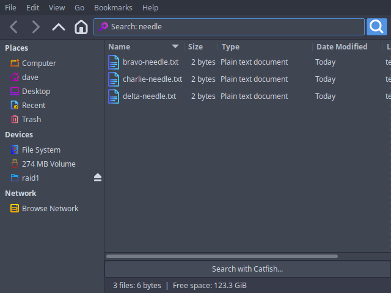

# Thunar fork — type-ahead recursive search

A fork of the Xfce file manager **Thunar** that adopts the Nautilus behaviour:

> Type anything into a focused Thunar window and it starts searching right away —
> no `Ctrl+F` first — and the search descends into subfolders.

Based on **Thunar 4.18.11**, the newest release that builds and runs on an
Ubuntu 24.04 / Xfce 4.18 stack (4.20+ needs exo ≥ 4.19, which that OS does not
have — see `docs/01-version-selection.md`).

Built, verified and installed on Ubuntu 24.04 / Xfce 4.18 on 2026-11-10:
`/usr/local/bin/thunar` (4.18.11) becomes the live file manager, shadowing the
distribution's `/usr/bin/thunar` (4.18.8), which stays installed and untouched.
Clean build, no new compiler warnings, eleven behaviour checks driven through
the real UI (`docs/04-testing.md`). `sudo scripts/uninstall.sh` reverses it.



## What is in this repository

The **changes**, not a copy of Thunar. The four patches, the scripts that
fetch, apply, build and install them, and the write-up of how the feature and
the two performance fixes work.

```
thunar_mods/
├── README.md                 this file
├── LICENSE                   GPL-2.0 — same terms as Thunar itself
├── patches/                  the fork, as four git-am-able patches
├── scripts/                  get-upstream · fetch-vendor · install-build-deps · build
│                             run-fork · install · uninstall · make-transfer-bundle
│                             target-install-xfce418-deps · target-install
│                             searchbench.py (compares search traversal strategies)
│                             ui-click-test.sh (drives the UI on a throwaway display)
└── docs/
    ├── 01-version-selection.md   why 4.18.11 and not 4.20.10
    ├── 02-feature-design.md      how the feature works, decision table, limitations
    ├── 03-build-and-install.md   building, running, installing, reverting, rebasing
    ├── 04-testing.md             what was tested and what happened
    ├── 05-porting-to-another-system.md   taking it to a second machine
    ├── 06-search-performance.md  why search crawled on network shares, and the fix
    ├── INSTALL-target.md         step-by-step for the target machine (ships as INSTALL.md)
    └── screenshots/              evidence for each test
```

Four directories are fetched or generated rather than tracked, and
`.gitignore` keeps them out:

| directory | what it is | how to get it |
| --- | --- | --- |
| `thunar/` | upstream's clone with the fork branch on top (~150 MB, has its own `.git`) | `scripts/get-upstream.sh` |
| `vendor/` | Xfce 4.18 core library tarballs, only needed for Xfce 4.16 targets | `scripts/fetch-vendor.sh` |
| `build/` | out-of-tree build output | `scripts/build.sh` |
| `dist/` | transfer bundles | `scripts/make-transfer-bundle.sh` |

Once `get-upstream.sh` has run, `thunar/FORK.md` describes what deviates from
upstream and why; it is carried inside the patches themselves.

## Quick start

```bash
scripts/get-upstream.sh              # clone Thunar 4.18.11, apply the patches
sudo scripts/install-build-deps.sh   # once
scripts/build.sh
scripts/run-fork.sh                  # try it without installing
sudo scripts/install.sh              # take over /usr/local, shadowing /usr/bin/thunar
thunar -q; hash -r; thunar --daemon &   # hand the session to the new binary
```

`sudo scripts/uninstall.sh` puts the distribution's Thunar back.

> `scripts/run-fork.sh` stops any running Thunar daemon first — otherwise a
> second `thunar` process just asks the already-running distribution binary to
> open a window, and nothing appears to change.

## The feature in one paragraph

A `key-press-event` handler on `ThunarWindow` sees plain printable keystrokes
before the views do and pushes them into the location bar's search entry, which
is what already drives Thunar's own search (`Ctrl+F` does the same thing, just
with an empty query). How deep the search goes stays under the existing
**Include subfolders** preference. `Escape` cancels, as it already did. The
handler stands aside for modified keys, non-printable keys, `Space`, `/`, `~`,
accelerators, custom-action shortcuts, and any keystroke while a text entry has
the focus — so renaming, the location bar and every existing shortcut behave
exactly as before. It can be switched off with **Search as you type** in
*Preferences → Advanced → Search*.

## The four patches

The fork is four commits on top of the upstream tag `thunar-4.18.11`:

1. **`0001`** — an upstream build fix (`cfa85fcdb`) cherry-picked, needed
   because automake 1.16.5 refuses the old `thunar.a` library name when the
   build system is regenerated from git.
2. **`0002`** — the feature itself.
3. **`0003`** — a search fix: breadth-first traversal, incremental results and
   a debounce, which is what makes searching a network share usable
   (`docs/06-search-performance.md`).
4. **`0004`** — an activation fix: clicking a result opens *that* folder and
   stops the search, which on a slow location it previously did not do at all.

Searching a 1.4 TiB SMB share for `QCAD` went from **nothing on screen after
45 seconds** to **16 hits after 5 seconds and 106 after 45** — level with
Nautilus, doing the same amount of SMB work — and a single click on a result
now opens it in under 4 seconds and leaves the share idle.

## Fork hygiene

`scripts/get-upstream.sh` clones `https://gitlab.xfce.org/xfce/thunar.git`,
branches `fork/4.18.11-typeahead` off `thunar-4.18.11` and applies
`patches/0*.patch` in order, preserving authorship. Upstream can be fetched and
the fork rebased onto a future 4.18.x tag at any time;
`scripts/make-transfer-bundle.sh` regenerates the patches from whatever the
branch then holds.

## Taking it to another machine

```bash
scripts/fetch-vendor.sh              # only for targets still on Xfce 4.16
scripts/make-transfer-bundle.sh      # -> dist/thunar-typeahead-transfer-<date>.tar.gz
```

The bundle is self-contained: a `make dist` source distribution of the patched
Thunar (so the target needs no autotools), the Xfce 4.18 core library tarballs
for targets still on Xfce 4.16, both target-side scripts, the patches, the docs
and a `SHA256SUMS`. On the far end it is two commands —
`target-install-xfce418-deps.sh` (only below Xfce 4.18) then
`target-install.sh`. Do not copy the binary: it is linked against the build
machine's glibc. `docs/05-porting-to-another-system.md` has the reasoning, the
per-distribution version table and the risks.

## Licence

Thunar is GPL-2.0-or-later and these patches are a derivative work, so this
repository is GPL-2.0-or-later throughout. See `LICENSE`.
