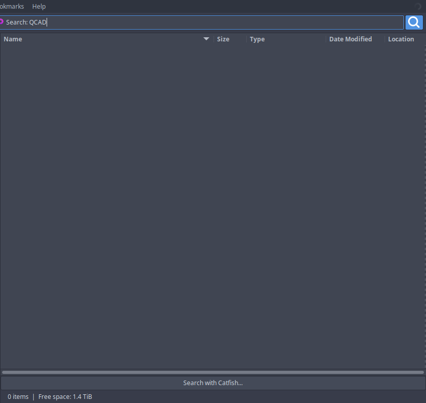
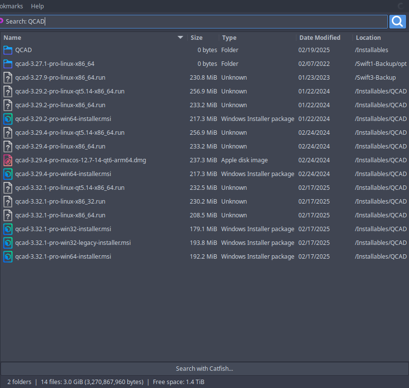
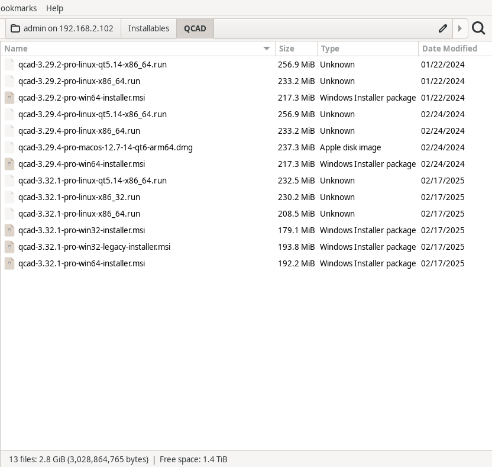

# Why search was slow on a network share, and what was changed

Reported: searching an SMB share for `QCAD` felt far slower in Thunar than in
Nautilus. Investigated and fixed on 2026-11-10.

Test subject: `smb://192.168.2.102/admin/`, mounted through gvfs, ~1.4 TiB,
deeply nested (backups, ROM collections, photo libraries, project folders).

## The measurement

Same share, same query, same starting folder (the share root), typed into a
focused window. `gvfsd-smb` CPU time is sampled alongside, to show how much
SMB work each one actually did.

| | items at 5 s | at 15 s | at 45 s | SMB CPU by 45 s |
|---|---|---|---|---|
| Thunar, before | 0 | 0 | **0** | 10.7 s |
| Thunar, after | **16** | 31 | **106** | 12.0 s |
| Nautilus 46.4 | ~12 on screen | ~12 on screen | ~12 on screen | 12.8 s |

The Thunar figures are the counts from its own status bar. Nautilus has no
item counter, so its column is what was visible in the window — a full screen
of QCAD hits within 5 seconds, still marked *Searching…* at 45 seconds, with
no way to read a total off the screen. The honest comparison is therefore
time-to-first-results, not totals: **Nautilus and the fixed Thunar both fill
the window inside 5 seconds; the old Thunar showed nothing at all in 45.**



The old Thunar was not idle and was not doing less work — it burned 10.7 s of
SMB daemon CPU in those 45 seconds, comparable to the other two. It had simply
found nothing it was willing to show yet.

## Why

Two things in `thunar_list_model_search_folder()`, both in the traversal
rather than in the per-file cost:

**1. It recursed into each subdirectory inline.** The walk was depth-first, so
it dived into `AA_Projects/...` and stayed there. Everything beside that first
subtree — including `Installables/QCAD/`, where the answer was — waited for it
to come back up. Nautilus pushes subdirectories onto a `GQueue` and pops from
the head (`nautilus-search-engine-simple.c`), so it sweeps the share level by
level and meets shallow hits almost immediately.

**2. It handed a folder's matches over only after that folder's whole subtree
was finished.** `files_found` was concatenated onto `model->files_to_add` at
the very end of the function, and the function did not return until all of its
recursive calls had. So the matches in the folder you started from were
delivered *last of all*, after everything below them. Nautilus flushes hits
every `BATCH_SIZE` (500) entries processed.

The 500 ms model-update timer was never the problem; it was being fed nothing.

**3. Every keystroke restarted the crawl.** `thunar_path_entry_changed()` calls
`thunar_window_update_search()` on each character, which reaches
`thunar_list_model_set_folder()`, which cancels the running job and launches a
new one. Typing `QCAD` started four crawls and threw three of them away, each
one discarding what it had found. This matters much more with the type-ahead
feature in this fork, where typing *is* how a search begins. Nautilus delays
its thread by `CREATE_THREAD_DELAY_MS` (500 ms), which absorbs a typing burst.

## Confirming the cause before changing anything

`scripts/searchbench.py` replays the three strategies over the same share
through the same GIO stack, with Thunar's exact attribute set:

```
$ scripts/searchbench.py --uri smb://192.168.2.102/admin/ --query QCAD \
    --mode serial-dfs --seconds 45
  dirs visited  4592   dirs/sec 102.0   matches   0   first match at  never

$ ... --mode serial-bfs --seconds 45
  entries seen 266215  dirs/sec  91.3   matches 106   first match at  0.2 s

$ ... --mode parallel-bfs --threads 8 --seconds 45
  dirs visited  5116   dirs/sec 113.1   matches 106   first match at  0.2 s
```

Depth-first and breadth-first visit directories at the same rate (~100/s); the
difference is entirely *which* directories they visit first.

Worth noting what the third line says: **eight threads bought 24 % more
directories, not 8×.** A gvfs mount is served by one `gvfsd-smb` process which
handles its operations serially, so parallel enumeration mostly queues up
behind itself. Threading the search would have been the obvious guess and
would have been nearly all cost for very little gain.

## The change

`thunar/thunar-list-model.c`, commit *Search breadth-first and report matches
as they are found*:

* subdirectories are pushed onto a `GQueue` and popped from the head, instead
  of being recursed into inline;
* each folder's matches are committed as soon as that folder has been read,
  and every `THUNAR_SEARCH_COMMIT_BATCH` (500) entries inside a large one;
* a changed query waits `THUNAR_SEARCH_START_DELAY` (250 ms) before its job is
  launched, so a word being typed produces one crawl instead of one per letter.
  `thunar_list_model_cancel_search_job()` disarms that timer, so cancelling an
  as-yet-unstarted search still works.

Nothing else changed: same attribute set, same `g_file_enumerate_children()`
call, same symlink handling, same preferences, same 500 ms model updates.



## What was *not* done, and why

* **Threads.** Measured first: 24 % for a large increase in complexity and a
  shared-state rewrite of the walker. The bottleneck is one gvfs daemon, not
  the client.
* **Asking for fewer attributes.** Thunar already asks for less than Nautilus
  does (Nautilus adds `time::modified`, `time::access`, `time::created` and
  `id::file`). Not the problem.
* **Skipping `thunar_file_get()` for matches.** It costs a `query_info` per
  *match*, not per file visited. On a query with thousands of hits this would
  be worth revisiting; on normal ones it is noise.
* **Changing `misc-recursive-search`.** Setting *Include subfolders* to
  "Local Files Only" would make a remote search instant by not searching, which
  is not the same thing as being fast. The default stays "Always".

## Upstreamability

This is a fix to Thunar's own search, independent of the type-ahead feature,
and it is a strict improvement for any slow or deep location — network shares,
spinning disks, fuse mounts. It applies to `thunar_list_model_search_folder()`
in 4.18.x and the function is substantially the same on master, so it is the
piece of this fork most worth sending upstream.

---

# Part two: clicking a result did nothing

Reported after the fix above went in: with single-click enabled, clicking a
folder in the search results on the share neither opened it nor stopped the
search. Nautilus opens the item and ends the search.

## What was actually happening

Traced with temporary `g_printerr()` calls along the activation path, running
on a throwaway Xvfb display so the test neither disturbed nor was disturbed by
the desktop (`scripts/ui-click-test.sh`):

```
DBG selection_changed: active_search=1      <- the user's click, dropped
DBG activate_selected_files: n_files=1 searching=1
DBG poke_files_finish: error=(none) target=admin on 192.168.2.102 is_dir=1
```

The click *did* activate a row — single-click was enabled and working. But the
file it opened was `admin on 192.168.2.102`, the share root: **the folder
already on screen.** Thunar faithfully re-opened the folder being searched,
which is indistinguishable from nothing happening.

Two independent causes:

**1. The selection was thrown away while searching.**
`thunar_standard_view_selection_changed()` returned early for the whole
duration of a search — one of the "row-related callbacks" disabled to speed
searching up in upstream commit `1644eb576`. It cannot tell the churn of
results streaming in from the selection the *user* just made, so the
`selected-files` notification never reached the action manager.
`thunar_action_manager_set_selected_files()` then took its "nothing is
selected" path, which substitutes the current directory:

```c
if (action_mgr->files_are_selected)
  action_mgr->files_to_process = thunar_g_list_copy_deep (selected_files);
else
  action_mgr->files_to_process = g_list_append (..., g_object_ref (action_mgr->current_directory));
```

The same stale selection feeds the context menu built for a search result, so
this is worth being aware of beyond the click.

**2. The crawl kept the location busy.** Poking the file to open it goes to the
same place the search is reading, and one gvfs backend process serves a mount's
requests in turn, so the open queued behind everything the search still had
outstanding.

## The fix

* Drop the guard in `thunar_standard_view_selection_changed()`. The three
  remaining guards — `rows_reordered`, `row_changed`,
  `select_after_row_deleted` — still cover the genuine per-row work that
  commit was aimed at.
* Stop the search from `thunar_action_manager_activate_selected_files()`
  before poking, via new `thunar_window_stop_search()` →
  `thunar_standard_view_stop_search()` → `thunar_list_model_stop_search()`,
  which cancels the crawl, flushes what it found and emits `search-done`, so
  the view leaves search mode exactly as when a search ends by itself. The
  results already found stay on screen.

## Measured, before and after

Same search, then a single click on the first result:

| | folder opens | SMB CPU in the 16 s after the click |
|---|---|---|
| before | never (20 s observed, search root re-opened) | 6.4 s — still crawling |
| after | **in under 4 s** | **0.0 s — share idle** |



And the guard removal costs nothing: the identical search still yields 16
results at 5 s, 31 at 15 s and 106 at 45 s, for the same SMB daemon CPU, so
the speedup that guard was added for is being carried by the other three.

## Note on the test method

Both parts were measured by driving the real application — the type-ahead
search, the click — rather than by reasoning about the code. The second round
runs on an Xvfb display (`scripts/ui-click-test.sh`), after a first attempt was
invalidated by the machine's actual user clicking during the run. An automated
UI test that fights the person at the keyboard measures neither of them.
